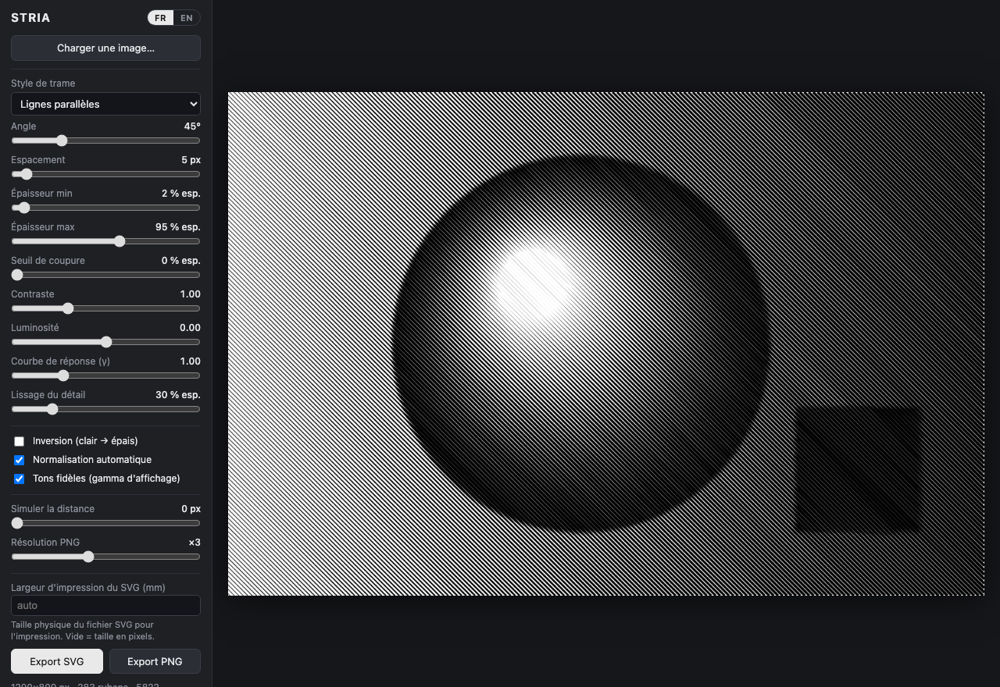

> [!WARNING]
> Ce projet a été vibecodé avec l’aide de l’intelligence artificielle.

# Stria

[](https://github.com/charlescoiffier/stria/actions/workflows/ci.yml)

Une application web qui transforme une image en une trame de **lignes noires parallèles sur fond blanc** : l'espacement
des lignes est constant, et c'est leur **épaisseur** qui traduit la luminosité de l'image, comme dans une gravure.
De près, on voit une trame régulière ; à distance, l'image réapparaît.

**Essayer l'application : https://charlescoiffier.github.io/stria/**

Aucune installation : tout se passe dans le navigateur, et rien n'est envoyé à un serveur.
Vous pouvez aussi télécharger [`index.html`](index.html) et l'ouvrir (double-clic) : il fonctionne hors ligne.



---

# Pour les utilisateurs

## Utiliser l'application

1. **Charger une image** : bouton « Charger une image… », glisser-déposer sur la zone d'aperçu, ou coller depuis le
   presse-papiers. Une image de démonstration est affichée au départ. Les photos comme les images quelconques conviennent.
2. **Régler la trame** avec les curseurs : l'aperçu se met à jour en direct.
3. **Exporter** : « Export SVG » (lignes vectorielles, idéal pour l'impression, la découpe ou le traçage) ou
   « Export PNG » (image haute résolution).

## Les réglages

| Réglage | Effet |
|---|---|
| **Angle** | Orientation des lignes (45° par défaut). |
| **Espacement** | Distance entre les axes de deux lignes voisines, en pixels de l'image. Plus il est petit, plus la trame est fine. |
| **Épaisseur min / max** | Épaisseur des lignes dans les zones claires / sombres, en % de l'espacement. À 100 % ou plus, les noirs deviennent pleins. |
| **Seuil de coupure** | Supprime les tronçons de ligne plus fins que ce seuil : les zones très claires deviennent du blanc pur. |
| **Contraste, Luminosité** | Ajustent l'image avant la conversion. |
| **Courbe de réponse (γ)** | Relation entre luminosité et épaisseur : au-dessus de 1, les tons moyens s'éclaircissent ; au-dessous, ils s'assombrissent. |
| **Lissage du détail** | Floute l'image avant calcul : variations d'épaisseur plus douces, moins de détails fins. |
| **Inversion** | Les zones claires deviennent épaisses (effet négatif). |
| **Normalisation automatique** | Étire la plage de tons de l'image pour utiliser toute la plage disponible. |
| **Tons fidèles** | Compense le gamma d'affichage pour que la luminosité perçue à distance corresponde à celle de l'image. |
| **Simuler la distance** | Floute l'aperçu pour juger de loin le résultat, sans modifier le dessin ni les exports. |
| **Résolution PNG** | Facteur d'agrandissement de l'export PNG (×1 à ×6, plafonné à 12 000 px de côté). |
| **Largeur d'impression du SVG (mm)** | Taille physique du fichier SVG : 300 donne un SVG de 300 mm de large, hauteur proportionnelle. Vide = taille en pixels. |

Le bouton **FR | EN**, en haut du panneau, change la langue de l'interface (le choix est mémorisé).

## Conseils

- Une photo contrastée, avec un sujet net, donne les meilleurs résultats. Pour une image terne, laissez la
  normalisation automatique activée et augmentez le contraste.
- L'espacement donne le « grain » : de 4 à 8 px pour une image de 1 800 px de large. Réduisez-le pour plus de détails.
- Pour un rendu plus graphique, augmentez le seuil de coupure ; pour un effet plus doux, augmentez le lissage.
- Les images sont réduites à 1 800 px sur leur plus grand côté pour le calcul. Le SVG, lui, est vectoriel et
  s'agrandit sans perte.

---

# Pour les développeurs

## Principe de l'algorithme

Chaque ligne est un **ruban** : un polygone fermé dont l'axe est strictement rectiligne et dont les deux bords sont à
±w(s)/2 de l'axe. Seule la largeur w varie, de façon continue le long de la ligne.

1. **Luminance** : gris perceptuel, normalisation (percentiles 1 % / 99 %), contraste et luminosité, inversion
   éventuelle, puis conversion en **couverture** (0 = blanc, 1 = noir) avec correction gamma si « tons fidèles ».
2. **Flou gaussien** (3 passes de boîte) de la carte de couverture, proportionnel à l'espacement.
3. **Géométrie** : repère tourné de l'angle choisi ; les axes sont à `v = k · espacement`, rognés aux bords de l'image.
4. **Échantillonnage le long de chaque ligne** (pas ≈ espacement / 4, interpolation bilinéaire), avec 5 prises
   perpendiculaires pondérées sur la bande entre deux lignes : on mesure ce que l'œil perçoit et on évite le moiré.
5. **Profil d'épaisseur** : `w = wmin + (wmax − wmin) × couverture`, lissé en 1D le long de la ligne, découpé en
   tronçons là où `w < seuil de coupure`, puis simplifié (Douglas-Peucker) pour un SVG léger.
6. **Rendu** : un seul `Path2D` pour l'aperçu et le PNG ; un `<path>` par ruban pour le SVG (coordonnées à 2 décimales,
   clipPath aux bornes de l'image).

## Organisation du dépôt

```
index.html            application complète et autonome (HTML + CSS + JS), sans dépendance
tests/                tests (node:test, sans dépendance)
  load-core.mjs         charge le cœur algorithmique d'index.html sans navigateur
  core.test.mjs         tests de l'algorithme (géométrie, épaisseurs, flou, simplification…)
  app.test.mjs          garde-fous sur index.html (script valide, traductions synchronisées)
scripts/build.mjs     valide index.html et le copie dans dist/
scripts/serve.mjs     petit serveur local de développement
.github/workflows/    intégration continue
```

`index.html` est volontairement **un seul fichier** : il s'ouvre par double-clic, sans serveur ni étape de build. Le
cœur algorithmique (fonctions pures `sampleBilinear`, `gaussBlur`, `smooth1D`, `simplifyProfile`, `clipRange`,
`buildRibbons`) est encadré par les marqueurs `/* @core-start */` et `/* @core-end */` : les tests extraient ce bloc et
l'exécutent dans Node. **Ne supprimez pas ces marqueurs, et gardez ce bloc indépendant du DOM.**

## Développer

Prérequis : Node.js 22 ou plus récent. Aucune dépendance à installer.

```bash
npm start       # serveur local : http://localhost:5173 (index.html relu à chaque rechargement)
npm test        # lance les tests
npm run build   # valide index.html et l'écrit dans dist/
```

On peut aussi ouvrir `index.html?test` : un auto-test géométrique s'exécute et écrit son résultat dans la console
du navigateur (`STRIA SELFTEST`).

Pour ajouter un texte à l'interface, ajoutez sa clé dans **les deux** dictionnaires `fr` et `en` de `I18N`, puis
référencez-la avec `data-i18n="clé"` (ou `T('clé')` en JavaScript) : un test échoue si une traduction manque.

## Intégration continue et déploiement

Le workflow [`.github/workflows/ci.yml`](.github/workflows/ci.yml) s'exécute à chaque push et à chaque pull request :
il lance `npm test`, puis `npm run build`. Un badge en tête de ce README reflète l'état du dernier run.

- Hors `main` (branches, pull requests), `dist/` est conservé une semaine comme artefact du run, ce qui permet
  d'essayer une branche sans rien publier.
- Sur un push vers `main`, si les tests et le build passent, `dist/` est publié sur GitHub Pages :
  <https://charlescoiffier.github.io/stria/>. La page est donc toujours à jour avec `main`.
